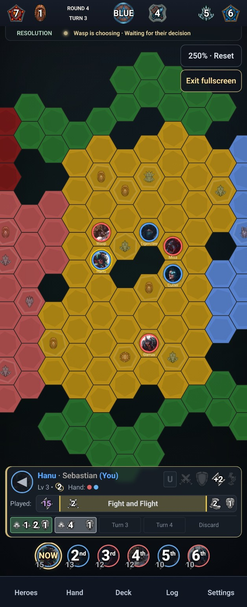
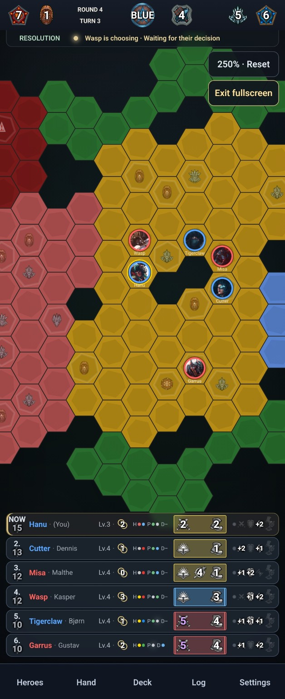
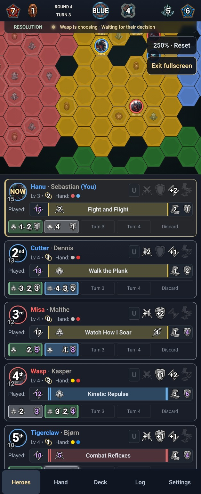
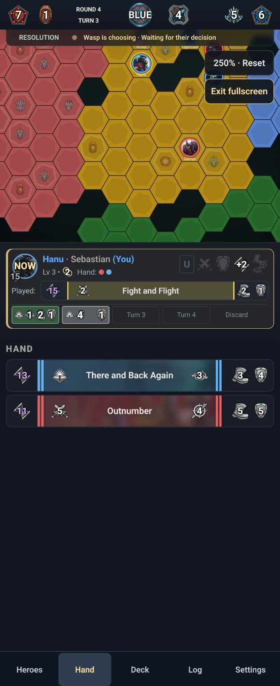
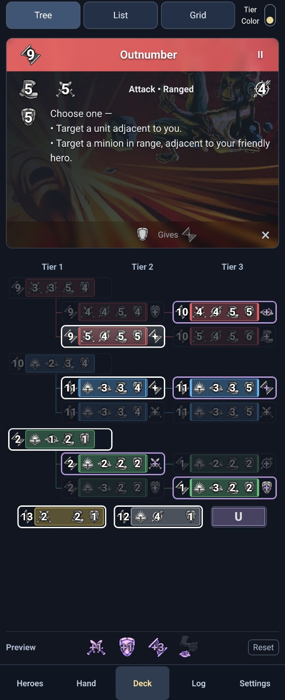

# GoA II — Mobile 2D

A mobile userscript for [Guards of Atlantis II](https://goa2.frontend.pedroliv.dev).
Open your game with `3d=0` in the URL. Supports portrait and phone landscape;
the website handles game rules and actions.

## Screenshots

Examples from **v1.02**. Click an image to view it full size.

<p>
  <a href="docs/screenshots/v1.02-board-expanded.jpg"></a>
  <a href="docs/screenshots/v1.02-board-compact.jpg"></a>
  <a href="docs/screenshots/v1.02-heroes.jpg"></a>
  <a href="docs/screenshots/v1.02-hand.jpg"></a>
  <a href="docs/screenshots/v1.02-deck.jpg"></a>
</p>

## Install

### Android — Firefox

I recommend **Firefox for Android** because it supports browser extensions, unlike Chrome for Android. This allows the script to be installed and managed cleanly through Greasemonkey.

1. Install [Firefox for Android](https://play.google.com/store/apps/details?id=org.mozilla.firefox).
2. Install [Greasemonkey](https://addons.mozilla.org/firefox/addon/greasemonkey/).
3. In Greasemonkey, choose **Install from URL**.
4. Paste:

   `https://raw.githubusercontent.com/SebastianKrog/goa2-mobile-2d-patch/main/dist/goa2-mobile-2d.user.js`

5. Reload the GoA2 page.

### Android — Chrome (bookmarklet)

1. In Chrome, bookmark any page (⋮ → ☆), then edit the bookmark and name it **GoA2 Patch**.
2. Replace the bookmark's URL with:

   `javascript:(()=>{const s=document.createElement('script');s.src='https://cdn.jsdelivr.net/gh/SebastianKrog/goa2-mobile-2d-patch@main/dist/goa2-mobile-2d.user.js';s.onerror=()=>alert('GoA2 patch could not load');document.head.appendChild(s)})()`

3. Open your GoA2 game with `3d=0` in the URL.
4. Type **GoA2 Patch** in Chrome's address bar and select the bookmark suggestion (not a search result).

Run it again after each page reload. The site's Content Security Policy may prevent loading the script.

### iPhone / iPad

On iOS, use Safari with the free [Userscripts app](https://apps.apple.com/us/app/userscripts/id1463298887). Enable its Safari extension, then install the script from the URL above.

## Use

- Board is the default view. Tap **Heroes**, **Hand**, **Deck**, **Log** or **Settings**; tap the active tab again to return to Board.
- Your hand dots or H/P/D indicators on Board open **Hand**; your upgrade icons open **Deck**. Device/browser **Back** closes the open menu and returns to Board.
- Tap a card to inspect it, or a hero name to focus that hero. Your played card appears above action choices.
- Deck offers **Tree**, **List** and **Grid**. Deck plans are previews; level-up choices require **Commit**.
- Long messages scroll automatically. Tap the message bar to read three rows; tap elsewhere to collapse it.
- Preferences and received events are saved on this device. Log also retrieves server decision history; local events cannot recover events missed while offline.

## Development

Use Node.js 24 (minimum 22.12).

```sh
npm ci
npm run build
npm test
```

Edit `src/`, rebuild, and commit source and generated `dist/` files together.

See [test coverage](tests/README.md), [stylesheet notes](src/STYLES.md),
[the changelog](CHANGELOG.md) and [planned work](ROADMAP.md).

## Attribution

The card painter is adapted from [PedroVIOliv/goa2-frontend-portfolio](https://github.com/PedroVIOliv/goa2-frontend-portfolio).
Card art, icons and fonts load from the game website.
